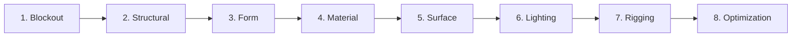

# PIPELINE IMAGE-TO-THREE.JS (IMG2THREEJS) — MODÉLISATION PROCÉDURALE PAR CODE

> **Inspiration & Référence :** Basé sur la méthodologie open-source [`img2threejs/img2threejs`](https://github.com/img2threejs/img2threejs).  
> **Philosophie :** Transformer n'importe quelle image de référence (personnage, mobilier, intérieur, produit tech, véhicule) en un composant **100% Three.js procédural en pur code JavaScript**, articulé, sans aucun fichier externe lourd (.glb/.obj), immédiatement intégrable dans les vidéos et le Studio VibeEditor.

---

## 🎯 1. Pourquoi le Code Procédural plutôt que des fichiers .GLB ?

| Critère | Fichier 3D externe (.glb / .obj) | Modèle Procédural `img2threejs` |
| :--- | :--- | :--- |
| **Poids & Chargement** | 5 Mo à 50 Mo (latence réseau, échecs CDN) | **0 Ko de fichier externe** (quelques lignes JS inline) |
| **Déterminisme vidéo** | Nécessite un `GLTFLoader` asynchrone qui bloque le scrubbing | **Instantané et synchrone** : 100% compatible avec `window.__timeline.seek(t)` |
| **Personnalisation** | Matériaux et maillages figés | **Matériaux, couleurs et dimensions modifiables en direct** |
| **Articulation & Rigging** | Armatures squelettiques complexes souvent cassées | **Hiérarchie de groupes et pivots natifs Three.js** contrôlables par GSAP |
| **Rendu & Shaders** | Risque d'incompatibilité de textures | **Contrôle total des shaders, PBR et émissions lumineuses** |

---

## 🏗️ 2. Le Protocole des 8 Passes Qualité (Staged Pipeline)

Pour reconstituer fidèlement un objet ou personnage à partir d'une image de référence, l'IA ne génère jamais le modèle "en vrac". Elle applique le protocole rigoureux en 8 passes :



### Pass 1 : Blockout & Proportions (Volume Global)
- Analyse de la silhouette maîtresse et de la boîte englobante ($Largeur \times Hauteur \times Profondeur$).
- Définition de l'origine du modèle : **systématiquement au sol au centre de la base** (`y = 0`).
- Normalisation de l'échelle : échelle 1:1 métrique (1 unité Three.js = 1 mètre). Exemples :
  - Humain adulte : hauteur $1.75\text{m} \dots 1.85\text{m}$.
  - Canapé 3 places : largeur $2.2\text{m} \dots 2.8\text{m}$, hauteur assise $0.45\text{m}$.
  - Smartphone : largeur $0.075\text{m}$, hauteur $0.16\text{m}$, épaisseur $0.008\text{m}$.

### Pass 2 : Structural Assembly (Hiérarchie des Sous-Groupes)
- Découpage en sous-ensembles logiques autonomes :
  ```javascript
  const model = new THREE.Group();
  const baseGroup = new THREE.Group();
  const mainBodyGroup = new THREE.Group();
  const articulatedParts = new THREE.Group();
  model.add(baseGroup, mainBodyGroup, articulatedParts);
  ```

### Pass 3 : Form & Silhouettes (Géométries Avancées)
- Remplacement des boîtes brutes par des primitives ajustées :
  - `THREE.CylinderGeometry` avec biseaux pour les bords arrondis.
  - `THREE.ExtrudeGeometry` via `THREE.Shape` pour les contours courbés (coques de téléphones, profils de sièges, corniches).
  - `THREE.LatheGeometry` pour les pièces de révolution (lampes, vases, verres, abat-jours).
  - `THREE.TorusGeometry` et `THREE.CapsuleGeometry` pour les poignées, coussins et articulations douces.

### Pass 4 : Material & PBR (Correspondance Chromatique)
- Extraction de la palette dominante de l'image (Primaire 60%, Secondaire 30%, Accent 10%).
- Matériau standard par défaut : `THREE.MeshStandardMaterial` ou `THREE.MeshPhysicalMaterial`.
- Paramétrage physique précis :
  - **Bois noble** : `color: 0x8b5a2b, roughness: 0.45, metalness: 0.05`
  - **Marbre poli** : `color: 0xfafafa, roughness: 0.15, metalness: 0.05`
  - **Métal laiton / or brossé** : `color: 0xd4af37, roughness: 0.25, metalness: 0.85`
  - **Tissu texturé** : `roughness: 0.85, metalness: 0.0`
  - **Verre fumé** : `roughness: 0.1, transparent: true, opacity: 0.35`
  - **Écran OLED éteint/allumé** : `roughness: 0.1, metalness: 0.7, emissive: 0x1e293b`

### Pass 5 : Surface Detailing (Micro-détails Réalistes)
- Ajout des éléments qui donnent vie à l'objet :
  - Lignes de fuite et rainures (bords biseautés sombres).
  - Poignées, boutons, coutures, pieds métalliques effilés.
  - Bords adoucis pour capter les reflets spéculaires de la lumière.

### Pass 6 : Integrated Lighting & Shadows (Éclairage Intégré)
- **Ombre de contact au sol** : Plan au niveau $y = 0.005$ avec dégradé d'opacité ou MeshStandard recevant l'ombre (`receiveShadow = true`).
- **Éléments luminescents** : Rubans LED (plinthes, derrière de meuble TV, suspensions) avec `MeshBasicMaterial({ color: 0xffedd5 })` ou matériau émissif.

### Pass 7 : Articulation & Rigging GSAP (Prêt pour l'Animation)
- **Règle absolue des pivots** : Le pivot d'un membre ou d'une pièce mobile doit être placé **exactement à l'axe de rotation** (articulation épaule, coude, hanche, genou, charnière de porte).
  ```javascript
  // Exemple d'un bras articulé avec pivot à l'épaule
  const armPivot = new THREE.Group();
  armPivot.position.set(shoulderX, shoulderY, shoulderZ); // Pivot à l'épaule
  
  const armMesh = new THREE.Mesh(armGeo, armMat);
  armMesh.position.y = -armLength / 2; // Le mesh descend depuis le pivot
  armPivot.add(armMesh);
  character.add(armPivot);
  
  // Animation naturelle par rotation pure du pivot
  armPivot.rotation.x = Math.sin(t) * 0.5;
  ```

### Pass 8 : Optimization (Performance & Sécurité)
- **Zéro valeur `NaN`** : Ne jamais multiplier un objet vecteur par un scalaire.
- **Zéro collision** : Les pièces mobiles doivent respecter les amplitudes biomécaniques réelles.
- **Nettoyage des ressources** : Partage des géométries et matériaux identiques entre plusieurs instances.

---

## 🧩 3. Templates Procéduraux Prêts à l'Emploi

### Modèle A : Personnage / Visiteur Stylisé (Walk-Cycle & Regard)
```javascript
function createProceduralCharacter(options = {}) {
    const palette = {
        skin: options.skinColor || 0xfad6bf,
        hair: options.hairColor || 0x1c1917,
        top: options.topColor || 0x2563eb,
        pants: options.pantsColor || 0x1e293b,
        shoes: options.shoesColor || 0xffffff
    };

    const character = new THREE.Group();
    const bodyRig = new THREE.Group();
    character.add(bodyRig);

    const mats = {
        skin: new THREE.MeshStandardMaterial({ color: palette.skin, roughness: 0.65 }),
        hair: new THREE.MeshStandardMaterial({ color: palette.hair, roughness: 0.75 }),
        top: new THREE.MeshStandardMaterial({ color: palette.top, roughness: 0.6 }),
        pants: new THREE.MeshStandardMaterial({ color: palette.pants, roughness: 0.7 }),
        shoes: new THREE.MeshStandardMaterial({ color: palette.shoes, roughness: 0.35 })
    };

    // Torse
    const torso = new THREE.Mesh(new THREE.CylinderGeometry(0.32, 0.28, 0.85, 16), mats.top);
    torso.position.y = 1.35;
    torso.castShadow = true;
    bodyRig.add(torso);

    // Tête
    const head = new THREE.Mesh(new THREE.SphereGeometry(0.24, 20, 20), mats.skin);
    head.position.set(0, 2.0, 0);
    head.castShadow = true;
    bodyRig.add(head);

    // Cheveux
    const hair = new THREE.Mesh(new THREE.SphereGeometry(0.255, 20, 20, 0, Math.PI * 2, 0, Math.PI * 0.58), mats.hair);
    hair.position.set(0, 2.03, 0);
    bodyRig.add(hair);

    // Épaules et Bras (Pivot aux épaules)
    function createArm(isLeft) {
        const side = isLeft ? 1 : -1;
        const pivot = new THREE.Group();
        pivot.position.set(side * 0.38, 1.68, 0);

        const sleeve = new THREE.Mesh(new THREE.CylinderGeometry(0.08, 0.07, 0.72, 12), mats.top);
        sleeve.position.y = -0.36;
        sleeve.castShadow = true;
        pivot.add(sleeve);

        const hand = new THREE.Mesh(new THREE.SphereGeometry(0.07, 10, 10), mats.skin);
        hand.position.y = -0.74;
        pivot.add(hand);

        bodyRig.add(pivot);
        return pivot;
    }

    // Jambes et Chaussures (Pivot aux hanches)
    function createLeg(isLeft) {
        const side = isLeft ? 1 : -1;
        const pivot = new THREE.Group();
        pivot.position.set(side * 0.16, 0.8, 0);

        const leg = new THREE.Mesh(new THREE.CylinderGeometry(0.1, 0.08, 0.8, 12), mats.pants);
        leg.position.y = -0.4;
        leg.castShadow = true;
        pivot.add(leg);

        const shoe = new THREE.Mesh(new THREE.BoxGeometry(0.16, 0.14, 0.34), mats.shoes);
        shoe.position.set(0, -0.78, 0.07); // Légèrement en avant (+Z)
        shoe.castShadow = true;
        pivot.add(shoe);

        bodyRig.add(pivot);
        return pivot;
    }

    const armL = createArm(true);
    const armR = createArm(false);
    const legL = createLeg(true);
    const legR = createLeg(false);

    // Contrôleur d'animation exposé pour GSAP
    character.userData = {
        setWalkCycle: (stepCycle) => {
            const swing = Math.sin(stepCycle * Math.PI) * 0.55;
            legL.rotation.x = swing;
            legR.rotation.x = -swing;
            armL.rotation.x = -swing * 0.75;
            armR.rotation.x = swing * 0.75;
            bodyRig.position.y = Math.abs(Math.sin(stepCycle * Math.PI)) * 0.045;
        },
        resetPose: () => {
            legL.rotation.x = 0;
            legR.rotation.x = 0;
            armL.rotation.x = 0;
            armR.rotation.x = 0;
            bodyRig.position.y = 0;
        }
    };

    return character;
}
```

---

### Modèle B : Îlot de Cuisine en Marbre Waterfall & Tabourets
```javascript
function createProceduralKitchenIsland(options = {}) {
    const island = new THREE.Group();

    const mats = {
        base: new THREE.MeshStandardMaterial({ color: options.baseColor || 0x1e2430, roughness: 0.5 }),
        marble: new THREE.MeshStandardMaterial({ color: 0xfcfcfc, roughness: 0.15, metalness: 0.05 }),
        leather: new THREE.MeshStandardMaterial({ color: 0x9a3412, roughness: 0.55 }),
        metal: new THREE.MeshStandardMaterial({ color: 0x0f172a, metalness: 0.9, roughness: 0.25 }),
        brass: new THREE.MeshStandardMaterial({ color: 0xd4af37, metalness: 0.85, roughness: 0.25 })
    };

    // Caisson bas
    const base = new THREE.Mesh(new THREE.BoxGeometry(2.4, 1.4, 5.0), mats.base);
    base.position.y = 0.7;
    base.castShadow = true;
    base.receiveShadow = true;
    island.add(base);

    // Plan en marbre avec retombée en cascade
    const marbleTop = new THREE.Mesh(new THREE.BoxGeometry(2.6, 0.14, 5.2), mats.marble);
    marbleTop.position.y = 1.45;
    marbleTop.castShadow = true;
    island.add(marbleTop);

    // Tabourets de bar
    [-1.6, 0, 1.6].forEach(z => {
        const stool = new THREE.Group();
        stool.position.set(-1.5, 0, z);

        const seat = new THREE.Mesh(new THREE.CylinderGeometry(0.36, 0.36, 0.1, 24), mats.leather);
        seat.position.y = 0.95;
        seat.castShadow = true;
        stool.add(seat);

        const stand = new THREE.Mesh(new THREE.CylinderGeometry(0.04, 0.04, 0.95, 12), mats.metal);
        stand.position.y = 0.475;
        stool.add(stand);

        island.add(stool);
    });

    return island;
}
```

---

### Modèle C : Smartphone Contemporain Ultra-fin (Mockup Produit SaaS)
```javascript
function createProceduralSmartphone(options = {}) {
    const phone = new THREE.Group();

    // Forme arrondie avec Shape et ExtrudeGeometry
    const shape = new THREE.Shape();
    const w = 0.75, h = 1.55, r = 0.12;
    shape.moveTo(-w/2 + r, -h/2);
    shape.lineTo(w/2 - r, -h/2);
    shape.quadraticCurveTo(w/2, -h/2, w/2, -h/2 + r);
    shape.lineTo(w/2, h/2 - r);
    shape.quadraticCurveTo(w/2, h/2, w/2 - r, h/2);
    shape.lineTo(-w/2 + r, h/2);
    shape.quadraticCurveTo(-w/2, h/2, -w/2, h/2 - r);
    shape.lineTo(-w/2, -h/2 + r);
    shape.quadraticCurveTo(-w/2, -h/2, -w/2 + r, -h/2);

    const extrudeSettings = { depth: 0.07, bevelEnabled: true, bevelSegments: 6, steps: 1, bevelSize: 0.02, bevelThickness: 0.02 };
    const chassisGeo = new THREE.ExtrudeGeometry(shape, extrudeSettings);
    chassisGeo.center();

    const chassisMat = new THREE.MeshStandardMaterial({ color: 0x18181b, metalness: 0.9, roughness: 0.2 });
    const chassis = new THREE.Mesh(chassisGeo, chassisMat);
    chassis.castShadow = true;
    phone.add(chassis);

    // Écran OLED avec bordures ultrafines
    const screenGeo = new THREE.PlaneGeometry(0.72, 1.5);
    const screenMat = new THREE.MeshStandardMaterial({ 
        color: 0x050505, 
        roughness: 0.05, 
        metalness: 0.8,
        emissive: options.screenColor || 0x2563eb,
        emissiveIntensity: 0.4
    });
    const screen = new THREE.Mesh(screenGeo, screenMat);
    screen.position.z = 0.057;
    phone.add(screen);

    return phone;
}
```

---

## 🎬 4. Liaison avec la Timeline GSAP

Tous les modèles construits via le pipeline `img2threejs` doivent être pilotés de manière 100% déterministe via GSAP :

```javascript
const tl = gsap.timeline({
    paused: true,
    onUpdate: () => renderer.render(scene, camera)
});
window.tl = tl;
window.__timeline = tl;

// Animation seek-safe du modèle procédural
const character = createProceduralCharacter();
scene.add(character);

const rigAnim = { cycle: 0 };
tl.to(rigAnim, {
    cycle: 20,
    duration: 10.0,
    ease: 'none',
    onUpdate: () => character.userData.setWalkCycle(rigAnim.cycle)
});
```

---

## ✅ 5. Liste de Contrôle Qualité Finale (Checklist)

Avant de valider une scène ou un composant issu de `image2threejs` :
- [ ] **Zéro asset externe** : Aucun appel réseau ni fichier `.glb` externe bloquant.
- [ ] **Origine au sol** : Le modèle repose à $y = 0$ avec une ombre de contact.
- [ ] **Proportions réalistes** : Dimensions conformes à la réalité (pas de personnages géants ou de canapés microscopiques).
- [ ] **Pivots articulés** : Les rotations s'effectuent depuis les joints naturels (épaules, hanches, coudes).
- [ ] **Zéro clipping** : Vérification des trajectoires pour qu'aucun objet ne traverse un mur, une table ou un meuble.
- [ ] **Pas d'effet plastique** : `roughness` et `metalness` calibrés selon la matière (bois mat, marbre lisse, métal brossé).
- [ ] **Déterminisme GSAP** : `window.__timeline.seek(t)` met à jour instantanément la scène sans saccade.
