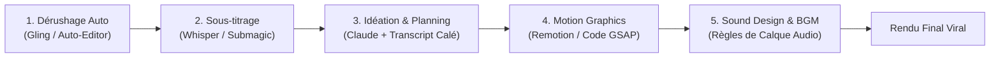

# 🎬 Rapport d'Analyse : Méthodologie & Montage Vidéo IA selon "Joseph | Video Editing"

> **Auteur analysé** : Joseph Eid (*Joseph | Video Editing* — Créateur & Fondateur de *Ultimate Editors 2.0*)  
> **Spécialité** : Montage vidéo haute rétention, animations motion design modernes (style SaaS / Apple / Iman Gadzhi), et industrialisation du montage via l'Intelligence Artificielle.

---

## 🧭 1. La Philosophie Centrale : "L'Artisanat avant le Prompt"

Dans ses vidéos phares (*« How to Edit a Viral Talking-Head Using ONLY AI »*, *« How to Edit Viral Instagram Reels Using Claude »*, *« How to Sound Design Any Video Using ONLY AI »*), Joseph martèle un principe fondamental :

> *« L'IA ne remplace pas les monteurs vidéo. Elle remplace les monteurs qui n'ont jamais compris les fondamentaux du montage et du storytelling. »*

Pour lui, beaucoup de créateurs font fausse route en essayant de copier des animations spectaculaires sans comprendre leur rôle. Le montage n'est pas un concours d'effets spéciaux : **c'est un système de livraison d'informations et de rétention visuelle**.

---

## ⚙️ 2. Le Workflow de Montage IA en 5 Phases

Joseph a formalisé un processus standard en 5 étapes qui permet de passer d'un rush brut à un Reel/Short viral en **30 à 45 minutes** (contre **3 à 4 heures** en montage manuel classique) :

### Phase 1 : Le Dérushage & Cut Automatique (2 min vs 15 min manuel)
* **Objectif** : Éliminer 100% des hésitations, silences, respirations et prises ratées.
* **Méthode** : Utilisation d'outils comme **Gling** (ou en open-source gratuit **`auto-editor`**). L'outil compare le script textuel à l'enregistrement audio et supprime automatiquement les temps morts pour produire un rush ultra-tendu (*tight cut*).

### Phase 2 : Le Sous-titrage Dynamique (2 min vs 20 min manuel)
* **Objectif** : Générer des sous-titres cinétiques synchronisés mot par mot.
* **Outils** : Submagic, Opus Clip, ou WhisperX en local.
* **Règle visuelle** : Utiliser un preset épuré avec surbrillance dynamique du mot actif et emojis contextuels parcimonieux (ne pas surcharger l'écran).

### Phase 3 : La Conception & le Storyboard avec Claude (5 min vs 25 min manuel)
C'est **l'étape la plus stratégique** où la plupart des utilisateurs échouent en demandant à l'IA d'improviser. Joseph procède avec une rigueur absolue :
1. **L'astuce du Transcript Calé** : Il n'envoie jamais un script brut sans timing à Claude. Il extrait d'abord le **transcript avec timecodes exacts** (seconde par seconde via Premiere ou Whisper). Cela permet à Claude de connaître la durée mathématique exacte de chaque plan.
2. **L'entraînement de l'agent IA** :
   - Il charge dans le contexte de Claude un guide de sa propre psychologie de montage.
   - Il impose une charte graphique stricte (Brand Guidelines : typographie, marges, palette de couleurs).
   - Il demande à Claude d'identifier uniquement les **moments à forte valeur ajoutée** (en moyenne 3 à 5 animations clés par vidéo de 60s) :
     - *0-3s* : Headline percutant (Hook).
     - *8-15s* : Décomposition du problème (UI Card 2 parties).
     - *25-35s* : Reframe / Graphique comparatif (Pie chart ou Barres).
     - *45-60s* : Révélation et Call to Action.
3. **Le Mockup préalable** : Il demande à Claude de valider un aperçu descriptif avant de générer le moindre code.

### Phase 4 : La Création Programmatique des Animations (10 min vs 90 min manuel)
* **Le changement de paradigme** : Remplacer After Effects par du **Code vidéo (Remotion / HTML5 Canvas / GSAP)**.
* Claude écrit directement le code des composants d'animation avec des paramètres de position, d'échelle et de couleur.
* **L'astuce secrète de transition (Dynamic Zoom)** : Pour relier les animations entre elles sans à-coups, Joseph applique un calque d'ajustement global avec un léger **recul de caméra (zoom-out fluide)** et un **micro-flou gaussien (2-3px)** sur les 4 premières frames de chaque apparition graphique.

### Phase 5 : Le Sound Design Structuré & BGM (15 min vs 30 min manuel)
Joseph applique une formule mathématique très stricte pour le sound design :
* **Un `Whoosh`** sur chaque mouvement de caméra ou zoom dynamique.
* **Un `Pop / Blip UI`** dès qu'un conteneur, une carte ou un badge apparaît à l'écran.
* **Un `Click` subtil** sur le premier mot des sous-titres clés.
* **BGM & Ducking** : La musique de fond est réglée à **-20 dB** sous la voix pour laisser la narration 100% intelligible.

---

## 🎨 3. Les 5 Principes de Design Graphique pour Monteurs Vidéo

Dans sa vidéo *« 17 Design Tips for Video Editors »*, Joseph explique que le niveau d'un monteur se juge à son respect des règles fondamentales du design :

| Principe | Mauvaise Pratique (Amateur) | Bonne Pratique (Pro / Joseph) |
| :--- | :--- | :--- |
| **1. Hiérarchie Visuelle** | Textes et badges de même taille à l'écran. | Découpage net : Grand Titre $\rightarrow$ Sous-titre moyen $\rightarrow$ Données fines. |
| **2. Contraste & Lisibilité** | Texte blanc posé directement sur un fond vidéo en mouvement. | Cartes en verre dépoli (*frosted glass*), ombres portées douces, boîtes de contraste. |
| **3. Padding & Marges** | Textes collés aux bords de l'écran ou aux bordures des cartes. | Respiration généreuse à l'intérieur des conteneurs ; respect strict des marges de sécurité. |
| **4. Alignement Géométrique** | Éléments positionnés "à l'œil", flottant de manière asymétrique. | Grille invisible stricte ; éléments alignés sur des axes verticaux et horizontaux constants. |
| **5. Règle des 3 Couleurs** | 5 à 6 couleurs néon différentes changeant à chaque scène. | **Charte 60-30-10** : Fond sombre neutre (60%), cartes ardoise/blanc (30%), accent signature unique (10%). |

---

## 🚀 4. Applications Directes pour Notre Projet (`heygen-new`)

Ce benchmark confirme que l'architecture technique que nous construisons dans notre application est exactement celle adoptée par l'élite des créateurs modernes :

1. **Génération Programmatique (HTML/GSAP vs Remotion)** :
   Notre choix d'utiliser du HTML5 + GSAP + CSS piloté par timeline est encore plus rapide et léger que Remotion, tout en offrant une prévisualisation instantanée à 60 FPS dans notre Studio.
2. **Le Transcript Calé pour l'Agent** :
   Fournir systématiquement à notre agent IA le fichier transcript horodaté (issu de Whisper) avant qu'il ne conçoive les scènes, afin que ses animations soient calées à la milliseconde près sur la voix.
3. **Le Sound Design Automatique par Règles** :
   Implémenter un script qui insère automatiquement un SFX `whoosh` sur chaque transition de caméra et un SFX `pop` sur chaque entrée de carte.
4. **Adoption d'Outils Open-Source Gratuits** :
   Intégrer en local **Edge-TTS** (voix naturelle gratuite illimitée), **WhisperX** (transcription mot-à-mot gratuite) et **Auto-Editor** (dérushage des silences gratuit).

