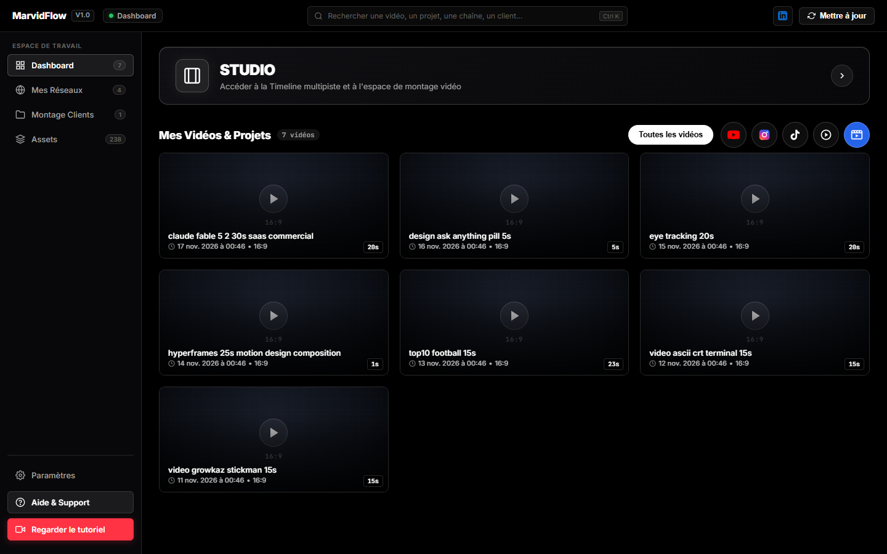
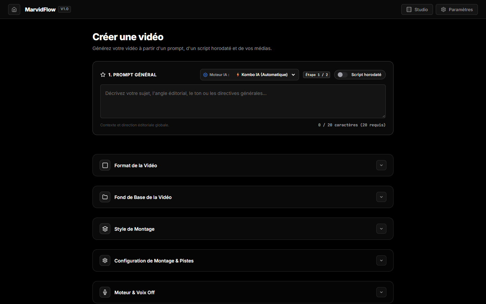
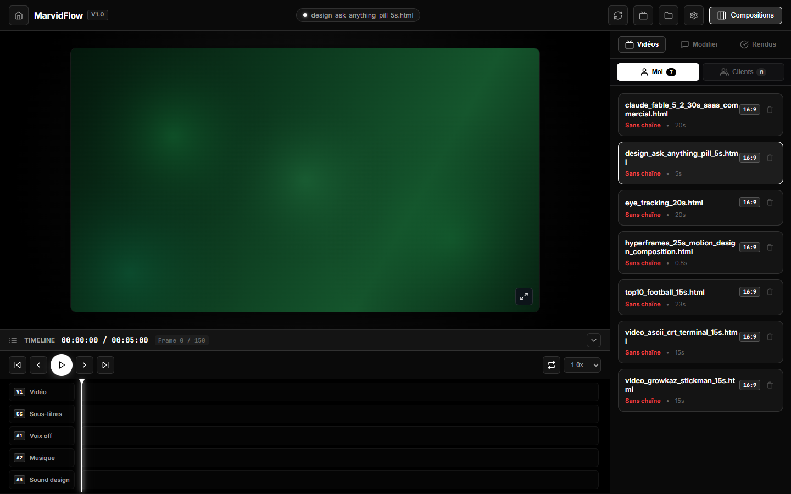
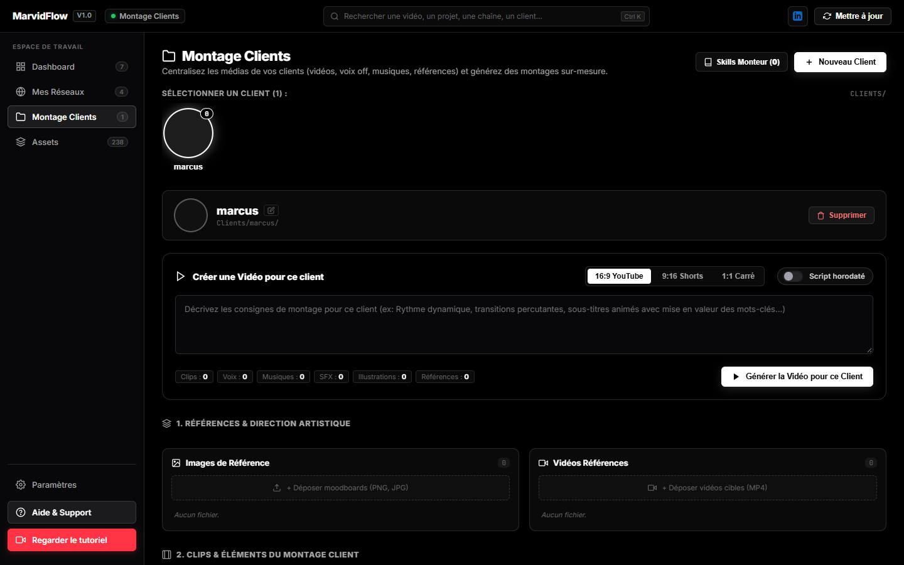

# MarvidFlow

**Générateur et studio de montage vidéo automatisé par IA**  
*De l'idée brute au rendu MP4 final : écriture de scénario, voix off studio, animations motion design et montage vidéo automatisé (TikTok, Instagram Reels, YouTube Shorts et vidéos longues).*



---

## Qu'est-ce que MarvidFlow ?

MarvidFlow est un logiciel complet de production vidéo assisté par intelligence artificielle. Il permet de créer des vidéos percutantes sans passer des heures sur des logiciels de montage traditionnels.

L'application résout deux besoins majeurs :

1. **Génération de vidéos complètes à partir d'un prompt** : Vous décrivez un sujet ou collez un texte brut. MarvidFlow génère le scénario, la voix off naturelle, les visuels animés, les transitions et les sous-titres dynamiques synchronisés.
2. **Montage automatisé de rushs existants** : Vous importez vos vidéos et prises vocales brutes. Le moteur découpe automatiquement les silences, supprime les mauvaises prises, recadre au format vertical (9:16) et applique votre charte graphique.

---

## Découverte de l'interface

### 1. Génération de vidéo par IA
Entrez vos directives éditoriales, choisissez le format cible et configurez les options de montage. L'orchestrateur IA assemble le script horodaté, les scènes et la voix off.



---

### 2. Studio de montage et Timeline multipiste
Visualisez votre composition avec scrub image par image à 60 FPS. Chaque élément est découpé en pistes indépendantes :
- **V1 Vidéo** : Plans, médias B-roll, animations graphiques
- **CC Sous-titres** : Sous-titres dynamiques synchronisés (style Hormozi)
- **A1 Voix off** : Narration vocale masterisée
- **A2 Musique** : Piste musicale d'ambiance avec ducking automatique
- **A3 Sound design** : Bruitages d'impact et transitions sonores



---

### 3. Espace Montage Clients et Rushes
Centralisez les projets de vos clients ou chaînes. Déposez les médias bruts (vidéos, musiques, voix, références graphiques) et lancez le montage en appliquant directement les consignes du client.



---

## Formats vidéo pris en charge

| Format | Ratio | Résolution standard | Plateformes cibles |
| :--- | :--- | :--- | :--- |
| **Vertical** | 9:16 | 1080 × 1920 | TikTok, Instagram Reels, YouTube Shorts |
| **Horizontal** | 16:9 | 1920 × 1080 | YouTube, tutoriels, formats longs cinéma |
| **Carré** | 1:1 | 1080 × 1080 | Instagram Feed, LinkedIn, Twitter/X |

---

## Installation et démarrage rapide

### Prérequis
- [Node.js](https://nodejs.org/) (version 18 ou supérieure)
- Google Chrome ou Microsoft Edge (utilisé pour la prévisualisation et le moteur de rendu)

### Installation
```bash
# 1. Cloner le dépôt
git clone https://github.com/NdarawFall/MarvidFlow.git
cd MarvidFlow

# 2. Installer les dépendances
npm install

# 3. Démarrer le studio
npm start
```
Le serveur local s'ouvre automatiquement dans votre navigateur à l'adresse :  
`http://localhost:3000/09_Pages/home.html`

---

## Configuration des clés API

MarvidFlow intègre une interface de configuration dédiée accessible dans l'onglet **Paramètres** de l'application :

- **Google Gemini** : Analyse de script, découpage scénaristique et direction artistique ([Obtenir une clé](https://aistudio.google.com/app/apikey))
- **ElevenLabs** : Voix off studio ultra-réaliste ([Obtenir une clé](https://elevenlabs.io/))
- **Brandfetch** (Optionnel) : Téléchargement automatique de logos vectoriels officiels de marques
- **TheSportsDB / Pixabay** (Optionnel) : Téléchargement de portraits de joueurs et visuels d'illustration

> **Sécurité** : Vos clés API sont stockées localement dans `07_Scripts/api_config.json`. Ce fichier est strictement ignoré par Git et n'est jamais publié sur GitHub.

---

## Espace Développeurs & Pipeline technique

Pour les développeurs souhaitant modifier le moteur ou automatiser des flux :

### Moteur de rendu (Pipeline headless)
1. Les scènes sont rendues en temps réel à l'aide de technologies web standard (**HTML5 Canvas, CSS3, GSAP 3.15, Three.js**).
2. Le script `07_Scripts/render.cjs` pilote une instance Puppeteer headless, capture les trames à 60 FPS constants et les injecte dans **FFmpeg** pour générer un fichier MP4 (H.264 / AAC) sans perte.

### Commandes disponibles

```bash
# Démarrer le studio web
npm start
# ou
npm run studio

# Lancer l'application en mode bureau natif Windows (Electron)
npm run desktop

# Lancer le rendu d'une vidéo spécifique en ligne de commande
npm run render -- 04_Videos/ma_video.html

# Compiler l'installeur Windows (.exe)
npm run dist
```

### Architecture du projet

```text
MarvidFlow/
├── 00_Skills/          # Règles d'animation, de typographie et direction artistique
├── 01_Assets/          # Médiathèque locale (musiques, effets sonores, logos, polices)
├── 02_Composants/      # Éléments réutilisables (sous-titres, badges, split-screens)
├── 03_Chaines/         # Profils de chaînes et Brand Kits (palettes, typographies)
├── 04_Videos/          # Pages HTML interactives prêtes pour la prévisualisation et l'export
├── 07_Scripts/         # Moteurs serveur et scripts de traitement :
│   ├── studio-server.cjs   # Serveur HTTP local, API REST et cache mémoire
│   ├── cut_silences.cjs    # Algorithme de découpage automatique des silences
│   ├── detect_bad_takes.cjs# Détection et suppression des hésitations/bafouillages
│   ├── auto_reframe.cjs    # Recadrage automatique 16:9 vers 9:16
│   └── render.cjs          # Moteur de capture Puppeteer et encodage FFmpeg
├── 08_Rendus/          # Fichiers MP4 finaux exportés (ignoré par Git)
├── 09_Pages/           # Interface utilisateur web du studio (HTML, CSS, JS)
├── Clients/            # Dossiers clients contenant leurs rushs bruts
├── docs/               # Documentation et captures d'écran
└── package.json        # Dépendances et configuration Electron
```

---

## Licence

Projet développé par **Ndaraw Fall**.  
Distribué sous licence **ISC**.
