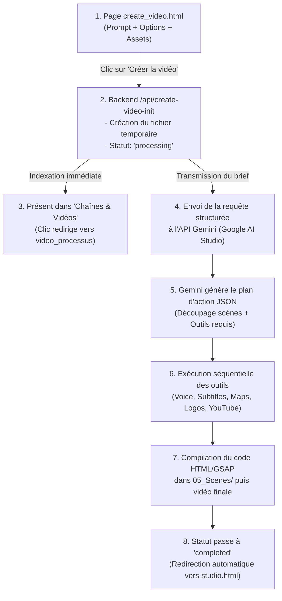

# Spécification Fonctionnelle & Technique : Workflow de Création Vidéo piloté par Gemini IA

Ce document décrit en détail le workflow complet de fabrication d'une vidéo via l'IA **Google Gemini (Google AI Studio)**, depuis la soumission du formulaire jusqu'à la finalisation dans le Studio.

> [!IMPORTANT]
> **Règles fondamentales** :
> 1. **Feuille de route officielle** : Aucune modification de code backend ne doit être implémentée avant validation complète de ce workflow.
> 2. **Interdiction de rendu autonome** : L'IA a **l'interdiction formelle de déclencher le rendu vidéo MP4 (`render.cjs` ou API de rendu)** sans l'autorisation expresse de l'utilisateur. Seul l'utilisateur déclenche ses rendus manuellement depuis Chrome / l'interface Studio ou sur demande explicite.
> 3. **Zéro barre de progression ni timeline/timecode incrusté dans la vidéo** : Ne jamais ajouter de barre de progression ou de timecode de debug sur le canvas vidéo. Le Studio possède déjà sa propre barre de défilement et ses compteurs.
> 4. **Zéro copie visuelle — Création 100% originale** : Ne jamais copier visuellement la structure, les graphismes ou les scènes d'une vidéo ou d'un composant existant sur le projet. Inventer des concepts visuels et du motion design sur-mesure pour chaque sujet.
> 5. **Bannissement des titrages scolaires / badges "PowerPoint"** : Ne jamais insérer de badges didactiques du type `[ Règle Fondamentale • 01 ]`, `[ Chapitre 1 ]`, `[ Étape 01 ]` en haut des scènes. Les titrages doivent être narratifs, immersifs et cinématiques.
> 6. **Bannissement du fond "Cliché IA" (Grille + Halo Sombre récurrent)** : Interdiction d'utiliser systématiquement le même arrière-plan générique (grille CSS de traits 1px + halo vert/cyan flouté sur fond noir). L'univers visuel, la lumière et la scénographie doivent être uniques et adaptés à chaque sujet.
> 7. **Mouvement de caméra continu & cadrage dynamique** : Finis les plans fixes statiques sans vie. Intégrer des travellings lents continus (push-in), des zooms tactiques dynamiques (focus macro sur les actions clés) et des dézooms fluides de recul.
> 8. **Animations différenciées par typologie d'élément** : Chaque type d'élément (titre, sous-titre, carte, icône, vecteur) doit avoir sa signature d'animation propre (kinetic text, smooth slide, tilt 3D, rotation élastique, tracé séquentiel).

---

## 1. Vue d'ensemble du Cycle de Vie d'une Vidéo



---

## 2. Création Préalable du Fichier, Nommage des Chaînes & Gestion des Statuts

### A. Règle de Création & Nommage du Dossier d'une Chaîne (`03_Chaines/`)
Lors de la création d'une chaîne par l'utilisateur :
1. Un suffixe alphanumérique unique est généré (ex: `12ABC`).
2. **Le dossier créé dans `03_Chaines/` doit obligatoirement porter le nom saisi par l'utilisateur + ce suffixe**, en remplaçant systématiquement les espaces par des tirets du 8 (`_`) :
   $$\text{Nom du Dossier} = \text{Nom\_Utilisateur\_avec\_underscores} + \text{"\_"} + \text{Suffixe}$$
   - *Exemple 1* : Nom utilisateur = `Tech & Futur` $\rightarrow$ Dossier = `03_Chaines/Tech_&_Futur_12ABC/`
   - *Exemple 2* : Nom utilisateur = `Histoire Secrète` $\rightarrow$ Dossier = `03_Chaines/Histoire_Secrete_78XYZ/`
3. **Suffixes des vidéos et assets de la chaîne** :
   Toutes les vidéos créées dans cette chaîne et tous leurs assets associés porteront ce même suffixe (ex: `03_Chaines/Tech_&_Futur_12ABC/video_nike-12ABC.html`, `01_Assets/Images/Tech_&_Futur_12ABC/image-12ABC.png`, etc.).

---

### B. Création Préalable Immédiate du Fichier Vidéo (`status: "processing"`)
Dès le clic sur « Créer la vidéo » :
1. Le serveur crée **immédiatement** le fichier HTML de destination :
   - Si rattachée à une chaîne : `03_Chaines/<Nom_Chaine_Suffixe>/<nom_video>-<suffixe>.html`
   - Si vidéo autonome : `04_Videos/<nom_video>-<suffixe_4_chiffres>.html`
2. Le fichier est initialisé avec des métadonnées de statut dans son en-tête `VIDEO_CONFIG` :
   ```javascript
   const VIDEO_CONFIG = {
       id: "vid_1793105000",
       title: "L'ascension de l'IA",
       suffix: "-12ABC",
       status: "processing", // 'processing' | 'completed' | 'error'
       processUrl: "video_processus.html?video=03_Chaines/Tech_&_Futur_12ABC/ascension_ia-12ABC.html",
       createdAt: 1793105000000,
       currentStep: "step_prompt",
       progress: 5
   };
   ```

---

### C. Comportement Visuel et Interactif selon l'Écran

#### 1. Sur la page « Chaînes & Vidéos » (`channels.html` et `channel.html`) :
- La vidéo apparaît **instantanément** dans la grille des vidéos.
- Elle affiche un badge visuel distinctif : 🟡 **« Génération en cours... »**.
- **Comportement au clic** :
  - **Tant que `status === 'processing'`** : Un clic sur la carte redirige l'utilisateur vers [`video_processus.html?video=...`](file:///c:/Users/ndara/heygen-new/09_Pages/video_processus.html) pour voir l'avancement de la création en direct.
  - **Dès que `status === 'completed'`** : Un clic ouvre normalement la vidéo dans [`studio.html?video=...`](file:///c:/Users/ndara/heygen-new/09_Pages/studio.html).

#### 2. Sur le Studio (`studio.html`) :
- Dans le volet droit (onglet « Vidéos »), le fichier vidéo en création apparaît dans la liste pour informer l'utilisateur de son existence.
- **État désactivé & non cliquable** :
  - La carte porte un badge 🟡 *« En création... »*.
  - Elle est grisée et désactivée (`opacity: 0.55`, `cursor: not-allowed`, `pointer-events: none`).
  - L'utilisateur ne peut pas la sélectionner.
- **Comportement du Player** :
  - **Le player n'affiche absolument rien** (`previewFrame.src = 'about:blank'`).
  - Le timecode reste à `00:00:00 / 00:00:00`, le nom affiche *« Vidéo en cours de génération... »* et les boutons de lecture sont désactivés tant que le fichier n'est pas finalisé (`completed`).

---

## 3. Requête Structurée Transmise à Gemini (Google AI Studio)

Quand l'utilisateur clique sur « Créer la vidéo », le serveur formate et expédie à Gemini une invite système experte ainsi qu'un objet JSON décrivant précisément le projet.

> [!NOTE]
> **Règle d'or Token Economy** :
> - L'IA commence par lire le fichier d'architecture [`.agents/rules/project-architecture.md`](./.agents/rules/project-architecture.md) pour avoir la cartographie résumée de tous les dossiers et fichiers résidentiels sans avoir à ouvrir de répertoires sans raison.
> - Aucune donnée d'image brute (binaire/base64) n'est envoyée dans la requête. Seuls les **chemins / URLs locaux exacts** de chaque asset uploadé sont transmis.
> - C'est à l'IA d'analyser le brief et de décider **en toute autonomie** quels scripts utilitaires (`07_Scripts/`) ou skills (`00_Skills/`) elle doit mobiliser.

### A. System Prompt (Rôle de Gemini)
```text
Tu es le réalisateur et moteur créatif de VibeEditor.
Tu as pris connaissance de l'architecture du projet via .agents/rules/project-architecture.md.
Ton rôle est d'analyser le brief et les assets fournis, de concevoir un découpage vidéo captivant,
et de sélectionner en toute autonomie les outils (07_Scripts/) et skills (00_Skills/) nécessaires.

RÈGLES STRICTES :
1. Tu ne crées JAMAIS d'images. Tu utilises exclusivement les assets locaux transmis via leurs chemins exacts.
2. Tout asset créé pour cette vidéo doit porter le même suffixe alphanumérique que la vidéo (ex: -12ABC).
3. B-Roll vidéo externe : Seul YouTube est autorisé si un lien ou un sujet d'archive précis est demandé.
4. Tu ne lis aucun dossier ou fichier sans raison afin d'économiser les tokens.
5. Tu réponds UNIQUEMENT par un JSON valide conforme au schéma attendu.
```

### B. Payload JSON envoyé à Gemini
```json
{
  "prompt": "Fais-moi une vidéo dynamique de 15s sur l'histoire secrète de Nike, avec leur logo et un extrait de pub culte",
  "channel_context": {
    "is_channel": true,
    "channel_id": "ch_tech_story",
    "channel_name": "Tech & Brands",
    "platform": "YouTube",
    "brand_colors": { "primary": "#ff3344", "secondary": "#111827" },
    "brand_fonts": { "title": "Outfit", "body": "Inter" },
    "logo_url": "01_Assets/Images/channels/avatar_ch_tech_story.png"
  },
  "uploaded_assets": [
    {
      "type": "image",
      "exact_path": "01_Assets/Images/ch_tech_story/chaussure_gaufrier-12ABC.png",
      "filename": "chaussure_gaufrier-12ABC.png"
    },
    {
      "type": "image",
      "exact_path": "01_Assets/Images/ch_tech_story/portrait_bowerman-12ABC.jpg",
      "filename": "portrait_bowerman-12ABC.jpg"
    }
  ],
  "preferences": {
    "format": "16:9",
    "duration_target": 15.0,
    "style": "template_histoire",
    "audio_setup": "full_mix",
    "subtitles": true,
    "video_suffix": "-12ABC"
  },
  "available_tools": [
    { "name": "brandfetch", "script": "07_Scripts/brandfetch.cjs", "purpose": "Télécharger logo vectoriel/PNG officiel d'une marque" },
    { "name": "fetch_map", "script": "07_Scripts/fetch_map.cjs", "purpose": "Générer une carte satellite/sombre haute résolution sans watermark" },
    { "name": "record_web", "script": "07_Scripts/record_web.cjs", "purpose": "Capturer une page/article web en Photo HD ou Vidéo MP4 défilante fluide" },
    { "name": "normalize_audio", "script": "07_Scripts/normalize_audio.cjs", "purpose": "Normaliser le son aux normes EBU R128 (-14 LUFS YouTube, -16 TikTok)" },
    { "name": "youtube_clip", "script": "07_Scripts/youtube_clip.cjs", "purpose": "Télécharger un extrait vidéo YouTube précis (seul B-Roll externe)" },
    { "name": "remove_bg", "script": "07_Scripts/remove_bg.cjs", "purpose": "Détourer le sujet d'une image utilisateur" },
    { "name": "generate_voice", "script": "07_Scripts/generate_voice.cjs", "purpose": "Synthèse vocale IA ElevenLabs/Gemini" },
    { "name": "transcribe_subtitles", "script": "07_Scripts/transcribe_subtitles.cjs", "purpose": "Calage temporel mot-à-mot des sous-titres" }
  ],
  "available_skills": [
    { "name": "video_design_mastery", "path": "00_Skills/video_design_mastery/SKILL.md", "purpose": "Appliquer les 17 principes de design (typographie 80/20, règle des tiers, 60/30/10, contrastes, empilement UI)" },
    { "name": "tegaki_handwriting", "path": "00_Skills/tegaki_handwriting/SKILL.md", "purpose": "Tracé d'écriture manuscrite vectorielle animée" }
  ]
}
```

### C. Réponse attendue de Gemini (Plan de Réalisation JSON)
Gemini répond avec un JSON strict contenant la feuille de route de production :

```json
{
  "video_title": "Nike : La Semelle Gaufrier",
  "total_scenes": 3,
  "required_tools_execution": [
    {
      "tool": "brandfetch",
      "args": { "query": "nike.com" },
      "output_dest": "01_Assets/Images/ch_tech_story/nike_logo.png"
    },
    {
      "tool": "youtube_clip",
      "args": { "search": "vintage nike waffle commercial 1970s", "duration": 4.0 },
      "output_dest": "01_Assets/Videos/ch_tech_story/nike_ad_clip.mp4"
    },
    {
      "tool": "generate_voice",
      "args": { 
        "text": "1971. Bill Bowerman verse du caoutchouc liquide dans le gaufrier de sa femme. La première chaussure Nike venait de naître.",
        "voice_id": "pNInz6obpgDQGcFmaJgB"
      },
      "output_dest": "01_Assets/Voix_Off/ch_tech_story/narration.mp3"
    },
    {
      "tool": "transcribe_subtitles",
      "args": { "audio_file": "01_Assets/Voix_Off/ch_tech_story/narration.mp3" },
      "output_dest": "01_Assets/Voix_Off/ch_tech_story/subtitles.json"
    }
  ],
  "scenes": [
    {
      "id": 1,
      "title": "L'Accroche Gaufrier",
      "start": 0.0,
      "end": 5.0,
      "visual_type": "user_image_kenburns",
      "asset": "nike_waffle_shoe.png",
      "headline": "UNE IDÉE DE GÉNIE",
      "animation": "zoom_in_rotate"
    },
    {
      "id": 2,
      "title": "Extrait d'Archive",
      "start": 5.0,
      "end": 9.5,
      "visual_type": "youtube_broll",
      "asset": "nike_ad_clip.mp4",
      "headline": "LA RÉVOLUTION DU RUNNING",
      "animation": "fade_slide"
    },
    {
      "id": 3,
      "title": "Conclusion & Branding",
      "start": 9.5,
      "end": 15.0,
      "visual_type": "motion_design_brand",
      "asset": "nike_logo.png",
      "headline": "JUST DO IT",
      "animation": "pop_bounce"
    }
  ]
}
```

---

## 4. Matrice Exhaustive des Facteurs Variant le Processus

Le nombre d'étapes, les outils invoqués et la durée du processus changent dynamiquement selon ces **10 facteurs clés** :

| Facteur | Variations Possibles | Impact direct sur le Workflow |
| :--- | :--- | :--- |
| **1. Choix du Style / Template** | `template_histoire` vs `motion_design` (libre) | Avec template : extraction des patterns de `06_Templates/video_histoire.html`.<br>Sans template : génération de code GSAP sur-mesure dans `05_Scenes/`. |
| **2. Présence de Chaîne** | Rattachée à une chaîne vs Vidéo autonome | Chaîne : lecture du Brand Kit (couleurs, typo, logo) et stockage dans `03_Chaines/<id>/`.<br>Autonome : suffixe aléatoire unique `-XXXX` apposé sur tous les assets et stockage dans `04_Videos/`. |
| **3. Piste Vocale (Voix Off)** | `Voix fournie` vs `Voix IA (ElevenLabs)` vs `Sans voix` | Voix fournie : normalisation et calcul de durée du fichier MP3.<br>Voix IA : appel à `07_Scripts/generate_voice.cjs` avec le timbre choisi (ex: Adam).<br>Sans voix : pas d'étape TTS ni sous-titres vocaux. |
| **4. Sous-titres** | `Activés` (`true`) vs `Désactivés` (`false`) | Si activés : exécution de `07_Scripts/transcribe_subtitles.cjs` pour produire le timing mot-à-mot (style Hormozi). Omission totale si désactivés. |
| **5. Musique d'Ambiance** | `Musique fournie` vs `Musique auto` vs `Aucune` | Si présente : mixage avec fondu d'entrée/sortie et ducking sonore sous la narration vocale. |
| **6. Effets Sonores (SFX)** | `full_mix` vs `sans SFX` | Si `full_mix` : injection des whooshes, bips et impacts synchronisés sur chaque transition de scène. |
| **7. Présence de Logo de Marque** | Prompt mentionnant une entreprise ou marque | Déclenchement de `07_Scripts/brandfetch.cjs` pour récupérer le logo SVG / PNG transparent officiel. |
| **8. Présence de Référence Géographique** | Prompt mentionnant une ville, pays, itinéraire | Déclenchement de `07_Scripts/fetch_map.cjs` pour générer une carte Leaflet/statique ou tracé GPS. |
| **9. Présence d'Extrait Vidéo (B-Roll)** | Lien YouTube ou mention d'archive/vidéo | Déclenchement de `07_Scripts/youtube_clip.cjs` (**unique source de B-Roll autorisée**). |
| **10. Détourage d'Images** | Directive *« sans fond »*, *« détouré »* | Déclenchement de `07_Scripts/remove_bg.cjs` pour isoler le sujet d'une photo importée. |

---

## 5. Fonctionnement en Direct de la Page `video_processus.html`

Pour que l'utilisateur suive l'avancement en temps réel (et puisse revenir sur la page à tout moment) :

1. **Endpoint de Statut `/api/video-progress?video=...`** :
   - Le serveur local maintient un objet d'état en mémoire pour chaque vidéo en cours de fabrication.
   - `video_processus.html` interroge cet endpoint (polling rapide toutes les 500 ms ou Server-Sent Events).
2. **Affichage Dynamique** :
   - Les étapes affichées correspondent **exactement au plan JSON renvoyé par Gemini**.
   - Chaque étape passe en `active` (spinner cyan) puis en `completed` (coche verte) dès que le script sous-jacent (brandfetch, generate_voice, etc.) termine avec succès.
   - Le faux terminal affiche les logs réels d'exécution issus des scripts.
3. **Transition Automatique vers le Studio** :
   - Dès que la dernière étape (`step_gsap_code` / `step_disk_save`) s'achève, le serveur met à jour `status = "completed"` dans le fichier vidéo.
   - La barre affiche 100%, et l'utilisateur est automatiquement propulsé dans [`studio.html?video=...`](file:///c:/Users/ndara/heygen-new/09_Pages/studio.html) avec la vidéo prête sur la timeline.

---

## 6. Prochaines Étapes pour l'Implémentation (Après Validation)

1. **Création du script d'orchestration Gemini** : `07_Scripts/gemini_director.cjs` (gérant l'appel API Google AI Studio avec la clé `google_api_key`).
2. **Mise à jour du endpoint `/api/create-video`** dans `07_Scripts/studio-server.cjs` pour exécuter le plan Gemini au lieu d'un template statique.
3. **Gestion du statut temporaire `processing`** dans `channels.html` et `studio.html` pour rediriger vers `video_processus.html` en cas de clic sur une vidéo en cours.

